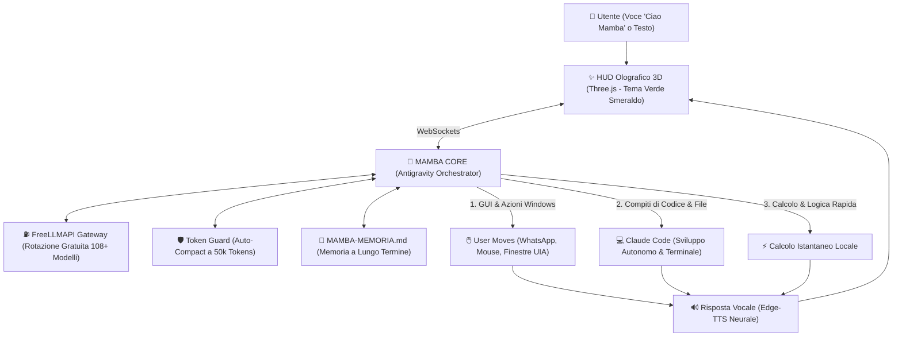

# 🐍 Mamba OS v2.0 — Autonomous Multi-Agent & Second Brain Cockpit

<p align="center">
  <b>Il sistema operativo cognitivo personale per Windows 11.</b><br>
  <i>Neural Glassmorphism Cockpit · Pixel Mamba Slither · Galaxy 3D Second Brain (SQLite FTS5) · Voce Neurale Edge-TTS con Coda · Claude Code & Terminal Bridge · Codex-Style MiniPet</i>
</p>

<p align="center">
  
  
  
  
</p>

---

## ⚡ Visione del Progetto
**MAMBA** è un sistema operativo cognitivo personale per Windows ispirato alla velocità e all'agilità del *Green Mamba*.  
Non è un semplice chatbot: è una **presenza attiva sul desktop** in grado di comprendere comandi in linguaggio naturale, muovere fisicamente il mouse, inviare messaggi su WhatsApp Desktop, sviluppare codice in autonomia con Claude Code e gestire la tua giornata con una voce neurale italiana ultra-fluida.

Tutto il ragionamento gira a **costo zero** appoggiandosi al router locale [FreeLLMAPI](freellmapi/README.md) con auto-rotazione su oltre 100+ modelli AI gratuiti.

---

## 🏗️ Architettura Multi-Agente



---

## 🌟 Caratteristiche Principali (v2.0)

* 👾 **Pixel Mamba Snake (60 FPS)**: Cobra pixelato frontale in `idle`, **serpente pixelato che striscia velocemente da sinistra a destra** quando elabora/scrive un prompt, ed equalizzatore audio reale quando parla.
* 🌌 **Galaxy 3D & Secondo Cervello Integrato (`brain_bridge.py`)**: Vista Galassia 3D interattiva integrata nell'HUD, ricerca istantanea `<20ms` SQLite FTS5 su ObsidianVault (`Contesto`, `Progetti`, `Decisioni ADR`, `Diario`) e Nightly Brain Gardener.
* 🔊 **Voce Neurale Italiana con Coda Non-Interrompente (`mamba/voice/tts_engine.py`)**: Edge-TTS (`Giuseppe`, `Diego`, `Isabella`, `Elsa`) con cache locale e coda audio che finisce sempre di leggere la risposta precedente prima di leggere la successiva.
* 🐾 **Codex-Style Mini & Pets (`desktop_pet.py`)**: Personaggetto desktop hot-reload single-instance configurabile per stile (`Pixel Viper` / `Classic`), dimensione, opacità, 5 skin e visibilità per singola app Windows.
* 🛠️ **Claude Code & Terminal Bridge + GitHub Sync**: Esecuzione diretta di Claude Code CLI (arricchito dal Secondo Cervello), PowerShell, apertura app/URL e stato/push GitHub 1-click dall'HUD.
* 🛡️ **Auto-Compact 50k Token Guard & User Moves**: Compattazione automatica sincronizzata col Vault + automazione desktop con Safety Gate.

---

## 📂 Struttura della Repository

```
mio/mamba/
├── README.md                      # 🌟 Questa pagina (Vetrina principale MAMBA)
├── HANDOFF.md                     # 🔄 Memoria di sessione universale cross-agent
├── gitpush.bat / gitpush.ps1      # 🚀 Backup istantaneo su GitHub (./gitpush)
├── handoff.bat / handoff.ps1      # 📝 Generatore snapshot locale (./handoff)
├── handon.bat / handon.ps1        # ⚡ Ripresa immediata sessione (./handon)
│
├── mamba/                         # 🐍 IL CUORE DI MAMBA OS
│   ├── core/                      # Orchestratore Antigravity, Router & Token Guard 50k
│   ├── moves/                     # Modulo User Moves (WhatsApp, Windows UIA, PyAutoGUI)
│   ├── voice/                     # Motore vocale neurale Edge-TTS
│   ├── ui/                        # Frontend Three.js olografico (Tema Verde Serpente)
│   └── data/                      # Memoria persistente locale
│
├── claude/                        # 💻 ECOSISTEMA CLAUDE CODE
│   ├── README.md                  # 📖 Guida completa configurazione e skill di Claude Code
│   └── ...                        # Configurazione e file dedicati
│
└── freellmapi/                    # ⛽ GATEWAY TOKEN GRATIS
    └── README.md                  # Configurazione router FreeLLMAPI porta 31415
```

---

## ⛽ Prerequisito: Download & Setup FreeLLMAPI

Mamba sfrutta [FreeLLMAPI](https://github.com/tashfeenahmed/freellmapi) come gateway locale per accedere a oltre **100+ modelli AI gratuiti** (Google Gemini, Groq, Cerebras, Mistral, OpenRouter) con failover intelligente e zero costi token.

### 📥 Link Ufficiali di Download

| Piattaforma | Pacchetto / Download Diretto | Istruzioni Rapide |
|-------------|------------------------------|-------------------|
| 🪟 **Windows** | [Scarica per Windows (.exe) ↗](https://github.com/tashfeenahmed/freellmapi/releases/latest) | Scarica `FreeLLMAPI-Setup-<versione>.exe` e avvialo (1 clic, nessun permesso admin) |
| 🍎 **macOS (Apple Silicon)** | [Scarica per Mac M1/M2/M3/M4 (.dmg) ↗](https://github.com/tashfeenahmed/freellmapi/releases/latest) | Scarica il file `-arm64.dmg` e trascina l'icona nella cartella *Applicazioni* |
| 🍏 **macOS (Intel)** | [Scarica per Mac Intel (.dmg) ↗](https://github.com/tashfeenahmed/freellmapi/releases/latest) | Scarica il file `-x64.dmg` e trascina l'icona nella cartella *Applicazioni* |
| 🐧 **Linux** | [Releases Ufficiali GitHub ↗](https://github.com/tashfeenahmed/freellmapi/releases/latest) | Disponibili pacchetti `.AppImage` o installazione da sorgenti |

---

### ⚙️ Configurazione in 1 Minuto:
1. **Avvia FreeLLMAPI**: Comparirà un'icona nella barra di sistema vicino all'orologio (Windows) o nella barra menu (macOS).
2. **Apri la Dashboard**: Vai nel browser all'indirizzo [http://localhost:3001](http://localhost:3001) (o la porta configurata).
3. **Inserisci almeno una chiave gratuita**: Nella scheda **Keys**, incolla una o più chiavi API gratuite:
   * [Google AI Studio (Gemini 2.5/Flash) ↗](https://aistudio.google.com/apikey) *(Consigliatissimo, generoso e velocissimo)*
   * [Groq Cloud (Llama 3.3 / Mixtral) ↗](https://console.groq.com/keys) *(Ultra-rapido)*
   * [Cerebras Cloud ↗](https://cloud.cerebras.ai/)
   * [OpenRouter ↗](https://openrouter.ai/settings/keys)
   * [Mistral AI Console ↗](https://console.mistral.ai/api-keys)
4. **Pronto!** Mamba effettua l'**Auto-Discovery automatico**: legge da solo la chiave unificata e la porta dal database SQLite locale (`freeapi.db`) senza che tu debba configurare variabili d'ambiente a mano.

---

## 📄 Workflow di Sessione & Backup

Questo progetto utilizza il ciclo di sessione a 3 comandi per azzerare il consumo di token e mantenere la repository GitHub come **copia di backup identica del progetto locale**:

| Comando | Descrizione | Ambito |
|---------|-------------|--------|
| `/handoff [focus]` | Salva e sintetizza la sessione corrente in locale in `HANDOFF.md` | **100% Locale** (zero chiamate di rete) |
| `/handon [sezione]` | Legge `HANDOFF.md` e riprende il lavoro all'istante con contesto pulito | **100% Locale** |
| `/gitpush` | Rileva modifiche, aggiorna `README.md` e carica tutto su GitHub | **Remoto** (Backup Completo) |
| `/gitpush --dry-run` | Mostra l'anteprima dei file e delle modifiche senza inviarle | Anteprima |

---

## 📌 Stato del Progetto & Avanzamento (Sincronizzato da HANDOFF.md)

*Ultimo aggiornamento: 2026-11-14 16:46:33*

**Obiettivo principale**: Sviluppo di MAMBA OS — Sistema Desktop Autonomo Multi-Agente (Orchestratore Antigravity, FreeLLMAPI a costo zero, HUD 3D Verde Smeraldo, User Moves e Claude Code Engine).  
**Stato attuale**: ✅ **Ristrutturazione Monorepo completata; fondamenta e comandi globali attivi**.

### 📁 Ultimi File Modificati / Rilevati nel Progetto:
| Data | File | Tipo | Descrizione |
|------|------|------|-------------|
| 2026-11-13 | freellmapi\README.md | md | Creato/Modificato |
| 2026-11-13 | mamba/ | file | Nuovo file |
| 2026-11-14 | freellmapi/README.md | md | Modificato |
| 2026-11-14 | .agents/ | agents/ | Nuovo file |
| 2026-11-14 | .codex/ | codex/ | Nuovo file |
| 2026-11-14 | AGENTS.md | md | Nuovo file |

### Checklist Prossimi Passi:
- [x] Creare repository GitHub e push iniziale
- [ ] Testare gitupdate --dry-run e sync reale
- [ ] Configurare GITHUB_TOKEN in settings.json per automazione GitHub
- [ ] Testare hook syntax check modificando un file .py o .ts
- [ ] Proviare /code-review su un file esistente
- [ ] Creare un workflow personalizzato in .claude/workflows/
- [ ] Testare le skill installate (auto-test, github-automation)
- [ ] Eseguire test per: test merge intelligente
- [ ] Testare gitpush --dry-run e sync reale
- [x] Configurato bypassPermissions per esecuzione autonoma di Claude Code
- [x] Connesso GitHub MCP con Personal Access Token
- [x] Implementati e testati comandi globali e locali `/handoff` e `/handon`
- [x] Implementato script `scripts/gitupdate.py` per merge e sync GitHub
- [x] Registrato comando `/gitupdate` nel menu di Claude Code
- [x] Testato sync bidirezionale con GitHub (test completato con successo)
- [x] Redatto documento architettura multi-agente in `Desktop/progetti ai/idea automatica.txt`
- [ ] Avvio Fase 1 del progetto multi-agente "Idea Automatica"
- [x] Implementato script `scripts/gitpush.py` per merge e sync GitHub
- [x] Registrato comando `/gitpush` nel menu di Claude Code
