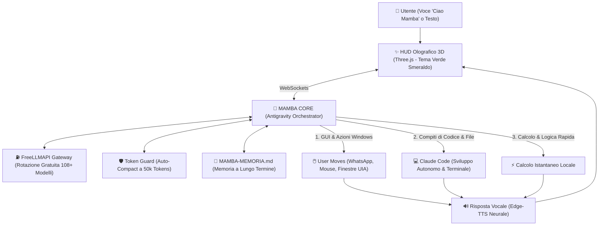

# 🐍 Mamba — Autonomous Multi-Agent Desktop OS

<p align="center">
  <b>L'assistente desktop autonomo multi-agente per Windows a costo token zero.</b><br>
  <i>Orchestrato da Antigravity · Ologramma 3D Verde Smeraldo · Voce Neurale · Automazione Desktop "User Moves" · Claude Code Engine</i>
</p>

<p align="center">
  
  
  
  
</p>

---

## ⚡ Visione del Progetto
**MAMBA** è un sistema operativo cognitivo personale per Windows ispirato alla velocità e all'agilità del *Green Mamba*.  
Non è un semplice chatbot: è una **presenza attiva sul desktop** in grado di comprendere comandi in linguaggio naturale, muovere fisicamente il mouse, inviare messaggi su WhatsApp Desktop, sviluppare codice in autonomia con Claude Code e gestire la tua giornata con una voce neurale italiana ultra-fluida.

Tutto il ragionamento gira a **costo zero** appoggiandosi al router locale [FreeLLMAPI](freellmapi/README.md) con auto-rotazione su oltre 100+ modelli AI gratuiti.

---

## 🏗️ Architettura Multi-Agente



---

## 🌟 Caratteristiche Principali

* 🐍 **Ologramma 3D Emerald Viper**: Interfaccia olografica fluida in Three.js con un orb particellare verde smeraldo e rete neurale che illumina le sinapsi in tempo reale durante il ragionamento.
* 🎙️ **Pipeline Vocale Nativa**: Attivazione vocale con *«Ciao Mamba»*, anti-eco automatico mentre parla, interruzione istantanea con *«Stop»* e voce neurale italiana via Microsoft Edge-TTS gratuita.
* 🛡️ **Auto-Compact 50k Token Guard**: Monitoraggio del contesto in tempo reale; al raggiungimento di 50.000 token, compattazione automatica e persistenza per sessioni infinite senza rallentamenti.
* 🖱️ **User Moves (Desktop Automation)**: Integrazione rapida con WhatsApp Desktop (deep-link istantaneo `whatsapp://send`), gestione delle finestre Windows e simulazione mouse con fail-safe di sicurezza.
* 💻 **Claude Code Engine**: Braccio di programmazione autonomo per creare file, lanciare test e mantenere la repository sincronizzata via Git.
* 🔄 **Ciclo di Sessione Universale**: Comandi nativi eseguibili in qualsiasi terminale: `./handoff`, `./handon`, `./gitpush`.

---

## 📂 Struttura della Repository

```
mio/ai/
├── README.md                      # 🌟 Questa pagina (Vetrina principale MAMBA)
├── HANDOFF.md                     # 🔄 Memoria di sessione universale cross-agent
├── gitpush.bat / gitpush.ps1      # 🚀 Backup istantaneo su GitHub (./gitpush)
├── handoff.bat / handoff.ps1      # 📝 Generatore snapshot locale (./handoff)
├── handon.bat / handon.ps1        # ⚡ Ripresa immediata sessione (./handon)
│
├── mamba/                         # 🐍 IL CUORE DI MAMBA OS
│   ├── core/                      # Orchestratore Antigravity, Router & Token Guard 50k
│   ├── moves/                     # Modulo User Moves (WhatsApp, Windows UIA, PyAutoGUI)
│   ├── voice/                     # Motore vocale neurale Edge-TTS
│   ├── ui/                        # Frontend Three.js olografico (Tema Verde Serpente)
│   └── data/                      # Memoria persistente locale
│
├── claude/                        # 💻 ECOSISTEMA CLAUDE CODE
│   ├── README.md                  # 📖 Guida completa configurazione e skill di Claude Code
│   └── ...                        # Configurazione e file dedicati
│
└── freellmapi/                    # ⛽ GATEWAY TOKEN GRATIS
    └── README.md                  # Configurazione router FreeLLMAPI porta 31415
```

---

## 📄 Workflow di Sessione & Backup

Questo progetto utilizza il ciclo di sessione a 3 comandi per azzerare il consumo di token e mantenere la repository GitHub come **copia di backup identica del progetto locale**:

| Comando | Descrizione | Ambito |
|---------|-------------|--------|
| `/handoff [focus]` | Salva e sintetizza la sessione corrente in locale in `HANDOFF.md` | **100% Locale** (zero chiamate di rete) |
| `/handon [sezione]` | Legge `HANDOFF.md` e riprende il lavoro all'istante con contesto pulito | **100% Locale** |
| `/gitpush` | Rileva modifiche, aggiorna `README.md` e carica tutto su GitHub | **Remoto** (Backup Completo) |
| `/gitpush --dry-run` | Mostra l'anteprima dei file e delle modifiche senza inviarle | Anteprima |

---

## 📌 Stato del Progetto & Avanzamento (Sincronizzato da HANDOFF.md)

*Ultimo aggiornamento: 2026-11-13 17:59:57*

**Obiettivo principale**: Sviluppo di MAMBA OS — Sistema Desktop Autonomo Multi-Agente (Orchestratore Antigravity, FreeLLMAPI a costo zero, HUD 3D Verde Smeraldo, User Moves e Claude Code Engine).  
**Stato attuale**: ✅ **Ristrutturazione Monorepo completata; fondamenta e comandi globali attivi**.

### 📁 Ultimi File Modificati / Rilevati nel Progetto:
| Data | File | Tipo | Descrizione |
|------|------|------|-------------|
| 2026-11-13 | handoff.ps1 | ps1 | Git: ?? |
| 2026-11-13 | handon.bat | bat | Git: ?? |
| 2026-11-13 | handon.ps1 | ps1 | Git: ?? |
| 2026-11-13 | claude\README.md | md | Creato/Modificato |
| 2026-11-13 | freellmapi\README.md | md | Creato/Modificato |
| 2026-11-13 | mamba/ | file | Nuovo file |

### Checklist Prossimi Passi:
- [x] Creare repository GitHub e push iniziale
- [ ] Testare gitupdate --dry-run e sync reale
- [ ] Configurare GITHUB_TOKEN in settings.json per automazione GitHub
- [ ] Testare hook syntax check modificando un file .py o .ts
- [ ] Proviare /code-review su un file esistente
- [ ] Creare un workflow personalizzato in .claude/workflows/
- [ ] Testare le skill installate (auto-test, github-automation)
- [ ] Eseguire test per: test merge intelligente
- [ ] Testare gitpush --dry-run e sync reale
- [x] Configurato bypassPermissions per esecuzione autonoma di Claude Code
- [x] Connesso GitHub MCP con Personal Access Token
- [x] Implementati e testati comandi globali e locali `/handoff` e `/handon`
- [x] Implementato script `scripts/gitupdate.py` per merge e sync GitHub
- [x] Registrato comando `/gitupdate` nel menu di Claude Code
- [x] Testato sync bidirezionale con GitHub (test completato con successo)
- [x] Redatto documento architettura multi-agente in `Desktop/progetti ai/idea automatica.txt`
- [ ] Avvio Fase 1 del progetto multi-agente "Idea Automatica"
- [x] Implementato script `scripts/gitpush.py` per merge e sync GitHub
- [x] Registrato comando `/gitpush` nel menu di Claude Code
