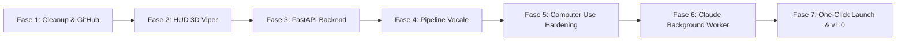

# 🐍 MAMBA OS — Master Plan & Architectural Roadmap

> **Documento:** Piano Architetturale e Tabella di Marcia Step-by-Step  
> **Versione:** 1.0.0-PRO  
> **Repository:** `https://github.com/danymammola-ops/mamba-os.git`  
> **Autore:** Dany Mammola & Mamba Core Team  
> **Data:** Novembre 2026  

---

## 🧭 1. Visione del Progetto & Filosofia

**MAMBA OS** è un sistema operativo cognitivo personale per Windows progettato per unire:
1. **L'estetica e l'intuitività** di un HUD olografico 3D fantascientifico (Three.js, tema *Emerald Viper Green* `#00ff88`).
2. **La potenza di automazione fisica** del *Computer Use* (controllo reale di mouse, tastiera, finestre e WhatsApp Desktop).
3. **L'indipendenza economica totale** (ragionamento multi-modello a **costo zero** tramite FreeLLMAPI locale su oltre 105+ modelli gratuiti).
4. **La longevità infinita del contesto** (Token Guard con compattazione automatica a 50.000 token).
5. **Il braccio ingegneristico autonomo** (Claude Code CLI per compiti di programmazione in background).

---

## ⚖️ 2. Analisi dell'Ambiente di Sviluppo: Claude Code vs Codex

| Parametro | Claude Code (Anthropic CLI) | Codex / OpenAI Operator | Verdetto Mamba OS |
|---|---|---|---|
| **Natura** | Agente CLI completo da terminale con accesso a file, git, bash, tool calling | Modello API di generazione codice / estensione IDE | **Claude Code vince** per l'orchestrazione |
| **Comprensione Repo** | Eccellente (legge l'intero grafo del repository, git log, file correlati) | Buona su singoli file, meno olistica su architetture multi-file | **Claude Code** è superiore per il refactoring |
| **Costo** | Configurabile su router locale / token Anthropic | A pagamento su API OpenAI | **FreeLLMAPI** azzera i costi di entrambi |
| **Ruolo in Mamba** | **Braccio esecutore di codice**: Mamba può lanciarlo in background per scrivere codice e fixare bug | Non necessario come ambiente separato | **Usiamo Claude Code** come motore background |

> **Conclusione Architetturale:**  
> Non abbiamo bisogno di un ambiente Codex separato. **Claude Code CLI** è l'ambiente ideale e più potente sul mercato per lo sviluppo locale e per operare come sotto-agente per compiti complessi di codice.

---

## 🔍 3. Punti di Forza di Jarvis TikTok (`jarvis-tiktok-copy`) da Integrare in Mamba

Dalla nostra analisi approfondita del progetto `jarvis-tiktok-copy`, ecco cosa prendiamo come riferimento d'eccellenza:

1. **HUD 3D Particellare reattivo alla voce (`scene.js`)**:
   - Sfera di particelle con rumore Simplex e post-processing *UnrealBloomPass*.
   - Rete neurale viva che illumina le sinapsi in tempo reale proporzionalmente ai decibel della voce.
   - *Adattamento Mamba:* Trasformazione completa dalla palette ciano/bianca al **Verde Smeraldo Viper** (`#00ff88`, `#05d672`, nero ossidiana `#060a08`).
2. **Sintesi Vocale Neurale Gratuita (`voice_service.py` / `audio.js`)**:
   - Utilizzo di Microsoft Edge-TTS con voce neurale italiana naturale (`it-IT-GiuseppeMultilingualNeural`).
   - Coda di riproduzione con buffer audio fluido senza interruzioni.
3. **Anti-Eco & Riconoscimento Vocale (`audio.js`)**:
   - Web Speech API integrata nel browser (latenza 0ms, zero consumo CPU).
   - *Echo Guard:* Disattivazione istantanea del microfono mentre Mamba parla per evitare che ascolti la propria voce.
4. **Router di Frasi Rapide a Token Zero (`phrases.js` + `calcolo.mjs`)**:
   - Risposte istantanee a battute, data, ora, stato batteria e calcoli matematici via Regex locali in **<15ms**, senza consumare token né attendere la latenza dell'LLM.

---

## 📌 4. Il Sistema di Checkpoint & Rollback

Per garantire che ogni passaggio sia sicuro e reversibile, è attivo il sistema di **Git Checkpoint**:
- Ogni volta che completiamo uno step, creiamo un checkpoint ufficiale:
  ```powershell
  ./checkpoint create <nome-step> "Descrizione di cosa è stato verificato"
  ```
- Per visualizzare tutti i checkpoint salvati:
  ```powershell
  ./checkpoint list
  ```
- Per tornare indietro istantaneamente a qualsiasi stato:
  ```powershell
  ./checkpoint restore <nome-step>
  ```
Tutti i checkpoint sono registrati storicamente nel file [`docs/CHECKPOINTS.md`](file:///C:/Users/danym/mio/mamba/docs/CHECKPOINTS.md).

---

## 🗺️ 5. Tabella di Marcia Step-by-Step (Roadmap Ufficiale)



---

### 🟢 FASE 1: Repository Refactor & Pulizia GitHub (IN CORSO)
*Obiettivo: Trasformare la repository in un progetto open-source pulito, professionale e privo di bozze disordinate.*
- [x] **Step 1.1 — Sistema Checkpoint**: Creato modulo `scripts/checkpoint.py`, script wrapper `./checkpoint.ps1` e `./checkpoint.bat`.
- [ ] **Step 1.2 — Correzione Codifica UTF-8**: Risolvere i caratteri speciali e le emoji corrotte nel `README.md` principale.
- [ ] **Step 1.3 — Pulizia Directory Radice**: 
  - Eliminare file temporanei (`agentiTerminale.txt`).
  - Rimuovere directory vuote (`src/`, `docs/` se non usate).
  - Organizzare la documentazione in `docs/` (`MASTER_PLAN.md`, `CHECKPOINTS.md`, `ARCHITECTURE.md`).
- [ ] **Step 1.4 — Ristrutturazione README GitHub**:
  - Badge professionali (Emerald Viper, 100% Free, Windows, AutoCompact 50k).
  - Diagramma architetturale ASCII / Mermaid.
  - Guida di avvio rapido in 3 comandi.
  - Tabella di download per FreeLLMAPI (Windows & Mac).
- 📌 *Checkpoint Finale Fase 1: `checkpoint/phase-1-repo-cleanup`*

---

### 🟢 FASE 2: Interfaccia Olografica 3D Emerald Viper (`mamba/ui/`)
*Obiettivo: Portare l'HUD 3D particellare di Jarvis in Mamba con la splendida palette Verde Smeraldo.*
- [ ] **Step 2.1 — Vendor Three.js Offline**:
  - Copiare `three.module.js` e i moduli postprocessing (`UnrealBloomPass.js`, `EffectComposer.js`, ecc.) in `mamba/ui/vendor/three/` per funzionare al 100% offline senza dipendenze `npm`.
- [ ] **Step 2.2 — Adattamento Shader & Colori Viper**:
  - Sostituire il bianco/ciano con la palette Emerald Viper (`#00ff88`, `#05d672`, bagliore `#20ff9d`, sfondo nero profondo `#060a08`).
  - Creare shader di pulsazione reattivi al livello vocale.
- [ ] **Step 2.3 — Layout HUD & Telemetria**:
  - Header: Logo Mamba, stato connessione, orologio, chip del cervello attivo (`FREELLM: Groq / Gemini`).
  - Pannello Sinistro: Widget telemetria live (CPU %, RAM %, Token Guard gauge `0 / 50.000 (0%)`).
  - Pannello Destro: Pulsanti di controllo rapido (WhatsApp, Mute Mic, Compact Memory).
  - Footer: Trascrizione live («TU: ...», «MAMBA: ...») e barra del microfono.
- 📌 *Checkpoint Finale Fase 2: `checkpoint/phase-2-hud-viper`*

---

### 🟢 FASE 3: Orchestratore Unificato FastAPI & WebSockets (`mamba/core/server.py`)
*Obiettivo: Eliminare il doppio server Node.js + Python e unificare tutto in un unico server Python ad altissime prestazioni.*
- [ ] **Step 3.1 — Server FastAPI Core**:
  - Servire i file statici della cartella `mamba/ui/`.
  - Canale WebSocket bidirezionale `/ws` per lo streaming di stati: `IDLE`, `LISTENING`, `THINKING`, `SPEAKING`, `EXECUTING`.
- [ ] **Step 3.2 — Router Locale Zero-Token (`instant_router.py`)**:
  - Risoluzione immediata a latenza 10ms per comandi locali: data, ora, meteo, percentuale batteria, saluti e calcoli.
- [ ] **Step 3.3 — Integrazione FreeLLMClient & TokenGuard**:
  - Endpoint `/api/chat` collegato al client con auto-failover (Groq / Gemini) e compattazione a 50k token.
- [ ] **Step 3.4 — Endpoint Telemetria `/api/status`**:
  - Stato FreeLLMAPI (modelli pronti), CPU/RAM (`psutil`), conteggio token in memoria.
- 📌 *Checkpoint Finale Fase 3: `checkpoint/phase-3-fastapi-server`*

---

### 🟢 FASE 4: Pipeline Vocale & Anti-Eco (`mamba/voice/`)
*Obiettivo: Parlare con Mamba a voce naturale e ricevere risposte vocali neurali istantanee.*
- [ ] **Step 4.1 — Sintesi Vocale Neurale (`/api/tts`)**:
  - Microsoft Edge-TTS con voce italiana `it-IT-GiuseppeMultilingualNeural` (o `Diego`).
  - Streaming diretto dei chunk audio MPEG al browser.
- [ ] **Step 4.2 — Motore Audio Web (`mamba/ui/audio.js`)**:
  - Gestione della coda vocale con Web Audio API.
  - Collegamento dell'analizzatore FFT alla sfera 3D particellare.
- [ ] **Step 4.3 — Riconoscimento Vocale Continuo (`Ears`)**:
  - Web Speech API in ascolto della wake word *«Mamba»* o *«Ciao Mamba»*.
  - Anti-eco automatico (mute istantaneo del microfono durante l'output vocale).
- 📌 *Checkpoint Finale Fase 4: `checkpoint/phase-4-voice-pipeline`*

---

### 🟢 FASE 5: Perfezionamento Computer Use & Desktop Automation (`mamba/moves/`)
*Obiettivo: Rendere il controllo di mouse, tastiera e finestre preciso al pixel ed eliminare ogni errore.*
- [ ] **Step 5.1 — Calibrazione Coordinate Finestre**:
  - Correggere l'offset del tasto Riduci a icona (`-`) rispetto a Ingrandisci (`□`) e Chiudi (`X`) tenendo conto dello scaling DPI di Windows 11.
- [ ] **Step 5.2 — Fallback Deterministico Win32**:
  - Supporto per comandi diretti su finestre via Win32 (`ShowWindow(SW_MINIMIZE)`, `SetForegroundWindow`) quando si richiede un'azione garantita al 100%.
- [ ] **Step 5.3 — Automazione WhatsApp Desktop Completa**:
  - Invio messaggi a qualsiasi contatto o numero con deep-link nativo `whatsapp://send` e invio automatico con Invio.
- [ ] **Step 5.4 — Visual Agent Closed-Loop**:
  - Ciclo continuo: Cattura ➔ FreeLLM Vision (1.5s) ➔ Spostamento fluido ➔ Click ➔ Verifica secondo screenshot.
- 📌 *Checkpoint Finale Fase 5: `checkpoint/phase-5-computer-use`*

---

### 🟢 FASE 6: Sotto-Agente Claude Code per compiti di Programmazione (`mamba/workers/`)
*Obiettivo: Permettere a Mamba di invocare Claude Code in background per sviluppare codice.*
- [ ] **Step 6.1 — Claude Code Bridge**: Modulo Python per eseguire comandi Claude Code senza bloccare il server principale.
- [ ] **Step 6.2 — Streaming Avanzamento nell'HUD**: Mostrare nell'interfaccia 3D quando Claude sta scrivendo codice o lanciando test.
- 📌 *Checkpoint Finale Fase 6: `checkpoint/phase-6-claude-agent`*

---

### 🟢 FASE 7: Packaging, Avvio in 1-Click & Release v1.0
*Obiettivo: Rendere il software avviabile con un doppio click su desktop e pubblicare la v1.0 ufficiale.*
- [ ] **Step 7.1 — Launcher `start-mamba.bat`**:
  - Verifica che FreeLLMAPI sia avviato (se no lo segnala o lo avvia).
  - Lancia il server FastAPI.
  - Apre automaticamente il browser a tutto schermo su `http://localhost:4173`.
- [ ] **Step 7.2 — Test End-to-End**: Verifica completa di voce, 3D, chat, memoria, automazione mouse e WhatsApp.
- [ ] **Step 7.3 — Sincronizzazione Finale GitHub**: Push di tutti i rami, creazione release v1.0 su GitHub.
- 📌 *Checkpoint Finale: `checkpoint/v1.0-mamba-os`*
